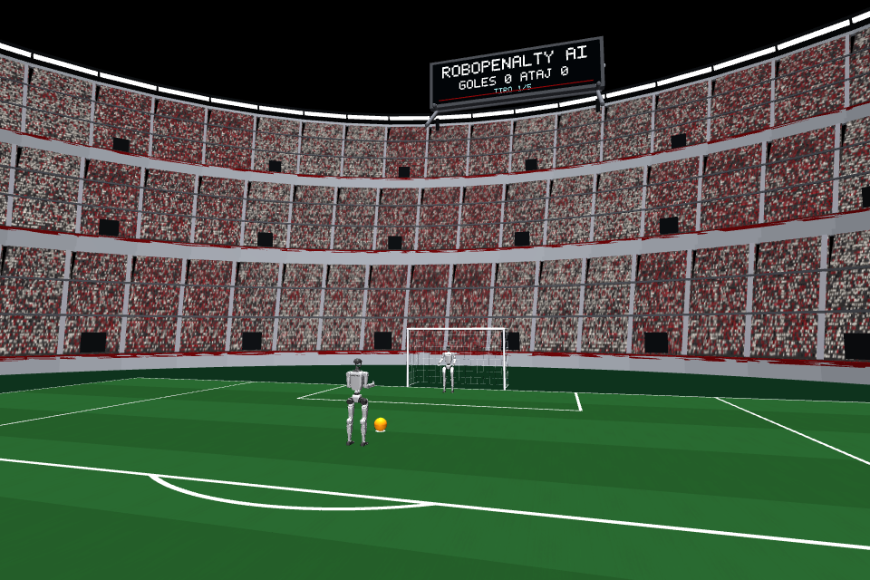
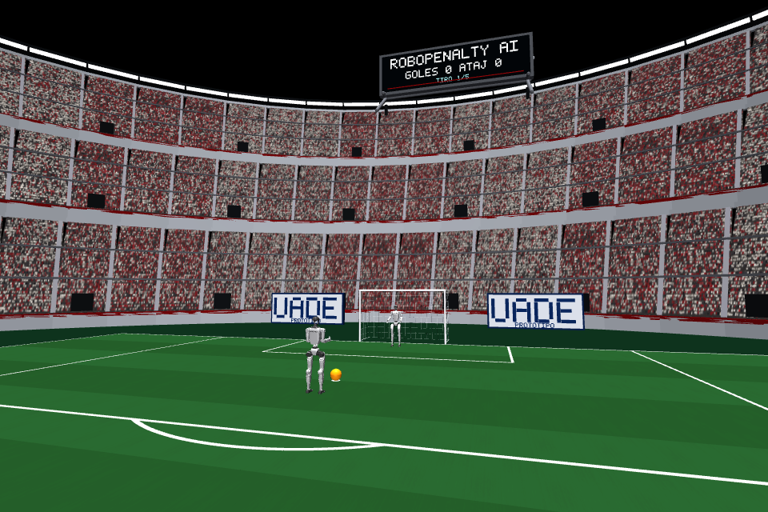

# Publicidad UADE: primer prototipo visual

**Referencia histórica V1.** La versión activa y sus resultados se documentan en [PUBLICIDAD_UADE_V2.md](PUBLICIDAD_UADE_V2.md). Las posiciones, cantidades y capturas que siguen corresponden al primer prototipo, no a la configuración actual.

Dos carteles de texto «UADE / PROTOTIPO» detrás del arco, uno a cada lado. **No reproducen el logotipo ni el escudo oficiales.** No se encontraron los archivos originales de las tres referencias en esta distribución, por lo que no se incorporaron imágenes institucionales ni se inventó un escudo. Las capturas de esta página son renders reales de MuJoCo, no imágenes conceptuales.

## Ejecución

Con la instalación habitual completa (104/104 recursos), desde la raíz:

```powershell
# Publicidad activada por defecto, una modalidad por vez:
.\scripts\jugar_automatico.ps1
.\scripts\jugar_dirigido.ps1

# Comparación con el mismo estadio, sin los dos carteles:
.\scripts\jugar_automatico.ps1 -SinPublicidad
.\scripts\jugar_dirigido.ps1 -SinPublicidad

# También se puede comprobar sin ventana:
.\scripts\jugar_automatico.ps1 -Headless -SinPublicidad
```

El argumento Python equivalente es `--no-institutional-ads`. `--no-decoration` también los oculta junto con la decoración general. El modo dirigido conserva sus órdenes habituales; el arquero permanece autónomo.

## Arquitectura y geometría

- `phase7d/institutional_ads.py`: genera rótulos propios con rectángulos de visualización; amplía U y D localmente sin cambiar la fuente histórica del marcador.
- `phase7d/visual_scene.py`: agrega los rótulos a `static`, después de construir el estadio. Las actualizaciones del marcador reconstruyen la escena a partir de esa lista, conservando los carteles.
- `phase7d/presentation.py`: usa la misma escena tanto en `viewer.user_scn` como al generar capturas del Renderer; registra cuántas primitivas publicitarias permanecen tras cada actualización.
- `phase9a/run_session.py` y los lanzadores solo transmiten la opción visual; no cambian el runtime 8C, los agentes ni la selección de acciones.

Centros mundiales: **(7, −4.5, 1.05) m y (7, +4.5, 1.05) m**. Cada panel mide 3.30 m de ancho y 1.30 m de alto; su frente mira hacia −X. Se separaron panel y letras en profundidad para evitar superficies coplanares. Son objetos `mjCAT_DECOR`, sin identificador de geom física; no se añaden al modelo compilado ni participan en contactos.

Los dos carteles suman **104 primitivas visuales**. En el estado final medido, la escena pasó de 1.269 a 1.373 primitivas; la cantidad de geometrías del modelo físico no cambia. No se agregan texturas, materiales del modelo, cuerpos, luces, actuadores ni recursos externos. La pantalla ROBOPENALTY AI y sus letras no se reemplazan.

## Capturas reales

Vista principal sin publicidad:



Vista principal con publicidad:



Otras cámaras:

- [Execution](images/uade_prototype/execution.png): uno de los carteles queda parcialmente recortado por el encuadre existente.
- [Overview](images/uade_prototype/overview.png): ambos aparecen, aunque a esta distancia no se espera leer el texto.
- [Goal](images/uade_prototype/goal.png): la cámara ve el reverso de un cartel en primer plano. El panel no oculta al arquero ni la pelota en la captura revisada.

Se priorizó `behind` sin cambiar cámaras para mejorar artificialmente la comparación. No se afirma legibilidad completa desde todos los ángulos. El estado inicial, los dos G1, la pelota y el arco permanecen visibles en la vista principal.

## Validación

Se ejecutaron cuatro tandas de cinco penales en una copia aislada dentro de `validation/uade_ads_20261030/`: automático y dirigido, cada uno con publicidad activada/desactivada. Se reutilizó un entorno de ejecución ya instalado; esta prueba no es una nueva validación del instalador ni una segunda computadora física. Los 26 recursos locales y sus avisos permanecen fuera del contenido público.

La secuencia común fue `right_inter_m080`, `right_open_m100`, `right_corner_m140`, `left_near_b060`, `center`. En dirigido se enviaron órdenes de texto mediante el fixture existente `Script`, sin simular reconocimiento de voz. Esas órdenes no actualizan el aprendizaje automático.

| Tanda headless | Publicidad | Tiempo de sesión | Tiempo del proceso | Resultado |
|---|---|---:|---:|---|
| Automática | No | 55,804 s | 58,603 s | 3 goles, 2 atajadas, 0 errados |
| Automática | Sí | 60,446 s | 67,241 s | 3 goles, 2 atajadas, 0 errados |
| Dirigida | No | 55,803 s | 60,216 s | 3 goles, 2 atajadas, 0 errados |
| Dirigida | Sí | 53,061 s | 57,116 s | 3 goles, 2 atajadas, 0 errados |

Cada tanda terminó con 70 s simulados y **35.000 pasos**, cinco contactos pie–pelota, controles físicos aprobados y ninguna caída del delantero ni excepción de simulación. El monitor corporal coincide exactamente con la referencia comparada.

Las dos tandas automáticas incluyeron ocho capturas RGB cada una; las dirigidas no. Son observaciones individuales, no un benchmark de FPS. No se atribuyen las diferencias de tiempo exclusivamente a los carteles o al renderizado.

Comparación de registros, sin tolerancias nuevas: **cero diferencias** entre publicidad activada/desactivada para estados iniciales, estado final completo de integración, contactos y evaluación, trayectorias registradas, guía lateral, decisiones, planificación, postura, retorno y monitor motor. También coincidieron las trazas físicas entre automático y dirigido con las mismas acciones y contra los JSON de la validación nominal previa de 8C. Las estadísticas de aprendizaje se compararon dentro de cada modalidad, respetando el historial manual separado.

El alcance es la identidad de esos registros y muestras disponibles; no implica comparar todos los estados intermedios que no se guardaron. Se excluyen tiempos reales, rutas, metadatos de presentación y selección manual/automática que son diferentes por diseño.

Los cinco reinicios se conservaron. Cada actualización registrada en las tandas con publicidad mantuvo las 104 primitivas; se cubrieron los cinco penales. La firma física permaneció igual antes/después de la presentación. Los 104 recursos externos de la copia local y todos los archivos de 8C, incluidas sus 37 calibraciones, conservaron sus SHA-256.

**175 tests aprobados**: los 170 existentes y cinco nuevos sobre geometría, persistencia, interruptor, fuente histórica y ausencia de cambios del modelo/estado. No se cambiaron tolerancias ni hashes de recursos. `docs/copied_files.json` identifica ahora los tres archivos propios que dejaron de ser copias intactas; conserva sus hashes históricos de origen. El inventario público registra sus bytes actuales.

También se comprobó el reenvío de `-SinPublicidad` en los dos lanzadores PowerShell, con cuatro casos activado/desactivado y un ejecutable de prueba que registra argumentos; esa comprobación no se presenta como una tanda física. En el primer montaje aislado faltaban avisos del registro de importación y el inventario de procedencia todavía describía archivos visuales editados como intactos: los controles detuvieron la prueba. Se completaron los avisos y se declaró la modificación de código propio, sin desactivar verificaciones. Los resultados anteriores corresponden a las ejecuciones finales correctas.

Se completó además una tanda automática de cinco penales con el visor nativo abierto: **3 goles, 2 atajadas, 35.000 pasos**, 126.408 s de sesión y 130.751 s de proceso. Registró 2442 sincronizaciones y capacidad visual de 100000 geoms; conservó los 104 elementos publicitarios en las actualizaciones de los cinco penales. La comparación con headless dio cero diferencias en las mismas trazas físicas. Se confirmaron cierre del visor, hilo de renderizado y trabajador de consola. Esta tanda incluía capturas RGB y pausas visuales; sus tiempos no son FPS ni costo de renderizado aislado. Los avisos de compatibilidad `version_base` de Hydra ya existentes no se corrigieron en este prototipo.

## Segunda versión propuesta

Revisar los archivos originales y las condiciones de uso antes de introducir logos oficiales. Mantener estas dos ubicaciones como referencia; evaluar tamaño o un reverso rotulado si se quiere mejorar `execution` y `goal`, sin mover cámaras ni alterar física. Conservar un presupuesto pequeño de primitivas y medir por separado el costo de capturas y del visor. No extender todavía la publicidad por el estadio.

Los logs y las trazas completos quedan en `validation/uade_ads_20261030/`, ignorados por Git. No se publicaron cambios ni se incorporaron modelos, NPZ o imágenes oficiales.
