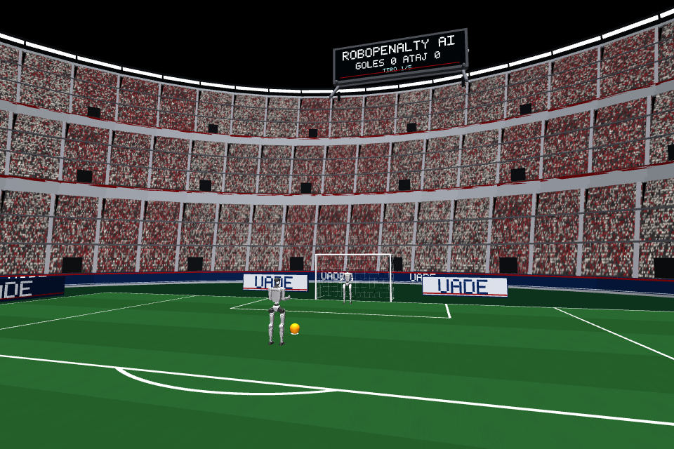

# Publicidad UADE — versión 2

Fecha de validación: 30/10/2026. Tipografía propia provisional, **sin logos, escudos ni archivos institucionales oficiales**. Se eliminó la palabra PROTOTIPO de los carteles; eso no convierte las letras en un logotipo autorizado. No se publicaron cambios.

## Diseño y ejecución

- Dos vallas traseras bajas, de 3,40 × 0,84 m, centradas en `(7.2, ±4.3, 0.47)` m. Llevan texto en ambas caras, orientado sin espejo. Sustituyen los paneles altos de V1.
- Seis vallas laterales, tres por lado, de 4,50 × 0,84 m: `X=−11, −5, 1`, `Y=±12.45`, `Z=0.47` m. El ancho sigue la línea lateral; los frentes miran al campo.
- Franja inferior del fondo: 12 segmentos visuales que siguen la herradura, de radio 19,7 m respecto de `(-8,0)`, centrados a Z=0,56 m. Cuatro sectores llevan UADE. No se alteran las gradas originales.
- Azul oscuro, blanco y detalles rojos; alternancia de vallas claras/oscuras. No se agregan luces ni texturas.
- Todas las primitivas quedan fuera del rectángulo marcado `X=[−15,5], Y=[−12,12]`. Los tests verifican sus envolventes rotadas, no solo sus centros. No hay publicidad sobre el césped.

Con una instalación completa de 104/104 recursos, desde la raíz, elegir una modalidad por vez:

```powershell
.\scripts\jugar_automatico.ps1
.\scripts\jugar_dirigido.ps1

# Comparar sin publicidad, conservando el estadio:
.\scripts\jugar_automatico.ps1 -SinPublicidad
.\scripts\jugar_dirigido.ps1 -SinPublicidad

# Alternativa sin ventana:
.\scripts\jugar_automatico.ps1 -Headless
```

Se conserva `--no-institutional-ads` en la entrada Python y la exclusión general `--no-decoration`. No cambia el parser, el control del juego ni la selección del delantero. El arquero sigue autónomo.

## Capturas reales comparables

Son renders MuJoCo de 960 × 640, con el mismo estado preparado y las cámaras existentes, sin mover robots ni cámaras para favorecer V2. El estado se leyó de la validación nominal anterior y se utilizó exclusivamente en el diagnóstico visual; las tandas físicas sí se reiniciaron y ejecutaron mediante el runtime normal.

| Cámara | V1 | V2 | Sin publicidad |
|---|---|---|---|
| Detrás del delantero | [V1](images/uade_v2/v1_behind.png) | [V2](images/uade_v2/v2_behind.png) | [Referencia](images/uade_v2/off_behind.png) |
| Ejecución | [V1](images/uade_v2/v1_execution.png) | [V2](images/uade_v2/v2_execution.png) | [Referencia](images/uade_v2/off_execution.png) |
| General | [V1](images/uade_v2/v1_overview.png) | [V2](images/uade_v2/v2_overview.png) | [Referencia](images/uade_v2/off_overview.png) |
| Arco | [V1](images/uade_v2/v1_goal.png) | [V2](images/uade_v2/v2_goal.png) | [Referencia](images/uade_v2/off_goal.png) |



En `behind` aparecen los dos paneles traseros y la franja del fondo. En `execution` los paneles son más bajos y el recorte de V1 se reduce; el marco cercano sigue junto al borde del encuadre. En `goal` desaparece el gran reverso azul del primer plano y aparecen las vallas laterales orientadas hacia el campo. En `overview` se reconoce el perímetro, pero no se promete leer palabras a esa distancia. Robots, pelota, arco y pantalla ROBOPENALTY AI conservan su representación; una valla puede quedar detrás de un robot o de la red por perspectiva.

La [documentación V1](PUBLICIDAD_UADE.md) y sus capturas se conservan como referencia histórica.

## Implementación y presupuesto

La composición está en `app/RoboPenalty/phase7d/institutional_ads.py`; sigue usando la integración estática 7D de V1. Genera la publicidad una vez al construir la escena y conserva los mismos objetos entre actualizaciones. No modifica el modelo compilado, los índices, los materiales/texturas del modelo, la física ni recursos externos. La escritura en `viewer.user_scn` y las capturas del Renderer reutilizan la arquitectura existente.

V2 usa **274 primitivas publicitarias**, con un límite preventivo de 400. Frente a las 104 de V1 son 170 adicionales; la escena visual preparada pasa de 1.373 a 1.543 primitivas. Sin publicidad hay 1.269 en ese estado. Estos números corresponden al estado medido; los trazos del marcador pueden variar según su contenido. Las cantidades de cuerpos, articulaciones, actuadores y geoms físicas no cambian.

La pantalla dinámica no se reemplaza. Los carteles se mantienen en `static`, por lo que sobreviven a actualizaciones de marcador y reinicios. No hay geometrías individuales por píxel ni público nuevo.

## Rendimiento visual medido

Para evitar atribuir calentamiento u orden de ejecución al diseño, se usó el mismo modelo, contexto, cámara `behind` y resolución. Se calentó el pipeline y se intercalaron **16 muestras por variante** con orden reproducible, sin partidas simultáneas. Las medias en milisegundos fueron:

| Variante | Publicidad | Geoms visuales | Construir escena visual | RGB + lectura de imagen | Pipeline completo |
|---|---:|---:|---:|---:|---:|
| Sin publicidad | 0 | 1269 | 36.44 | 84.43 | 120.96 |
| V1 | 104 | 1373 | 42.11 | 87.02 | 129.26 |
| V2 | 274 | 1543 | 43.99 | 87.44 | 131.53 |

El total incluye `update_scene`, `populate` y `render`; no incluye guardar PNG. En esta muestra V2 costó 1.76% más que V1 en el pipeline completo y 0.49% más en la llamada RGB. Las capturas secuenciales iniciales mostraron mayor variabilidad, por eso se separan en `render_cost.json` y no se usa una única toma favorable como conclusión.

**No son FPS del visor ni tiempos exclusivos de GPU.** `Renderer.render()` incluye lectura RGB. En el visor, la escena estática se reconstruye con los cambios de estado/marcador, no en cada paso físico. La muestra local no garantiza el mismo costo en otro hardware.

## Validación física y funcional

Se creó otra copia aislada dentro de `validation/uade_ads_v2_20261030/`. Se reutilizó un entorno Python ya validado; no se afirma una instalación limpia nueva ni una prueba en otra computadora física. Los recursos locales y sus avisos se mantuvieron fuera del paquete público. V1 se guardó antes de editar el módulo.

Semilla 2026, cinco penales y acciones comunes: `right_inter_m080`, `right_open_m100`, `right_corner_m140`, `left_near_b060`, `center`. El modo dirigido recibió órdenes de texto mediante el fixture existente `Script`; no se simuló reconocimiento de voz ni se cambió su aprendizaje.

| Modalidad headless | Publicidad | Sesión real [s] | Proceso [s] | Goles / atajadas / errados | Pasos |
|---|---|---:|---:|---|---:|
| auto | No | 54.606 | 57.631 | 3 / 2 / 0 | 35.000 |
| auto | Sí | 53.046 | 56.064 | 3 / 2 / 0 | 35.000 |
| directed | No | 50.409 | 53.341 | 3 / 2 / 0 | 35.000 |
| directed | Sí | 51.604 | 54.443 | 3 / 2 / 0 | 35.000 |

Cada tanda simuló 70 s. Hubo cinco contactos pie–pelota, controles físicos aprobados y ninguna caída del delantero ni excepción de simulación. La postura y el monitor motor coincidieron con los registros nominales.

Se ejecutaron además dos tandas automáticas completas en el visor nativo:

| Publicidad | Sesión real [s] | Proceso [s] | Llamadas sync acumuladas [s] | Pausas visuales [s] | Sincronizaciones |
|---|---:|---:|---:|---:|---:|
| No | 127.755 | 131.297 | 1.215 | 16.785 | 2484 |
| Sí | 127.772 | 130.990 | 1.198 | 16.753 | 2525 |

Ambas terminaron 3–2, con 35.000 pasos, el mismo mundo físico y cierre del visor/hilo/trabajador de consola confirmado. Los tiempos incluyen simulación, pacing, coordinación y pausas; las llamadas `sync` no aíslan todo el renderizado asíncrono. No se interpretan sus diferencias como una mejora o degradación causal de FPS.

**176 tests aprobados**: los 170 previos y seis visuales, incluyendo presupuesto geométrico, exclusión del césped, dos caras traseras, ausencia de la leyenda anterior, determinismo, persistencia, interruptor y firma del modelo/estado. La comprobación de población confirma categoría decorativa y ausencia de identificadores de geometría física.

Comparaciones exactas, sin tolerancias nuevas: publicidad activada/desactivada en ambos modos; automático/dirigido con idénticas acciones; headless/visor con cada configuración; y la referencia nominal anterior de 8C. Se contrastaron configuración, estados iniciales y finales de integración, contactos/evaluación, trayectorias registradas, guía lateral, decisiones, planificación, postura, retorno y monitor motor. **Cero diferencias** en los registros comparados. El alcance son esas muestras disponibles, no todos los estados intermedios no guardados.

Los tiempos reales, rutas, metadatos visuales y diferencias legítimas de selección manual/automática no se compararon como física. Las estadísticas de aprendizaje se compararon dentro de cada modalidad; las órdenes dirigidas conservaron su historial separado. Se verificaron las actualizaciones de los cinco penales y la permanencia de 274 primitivas con publicidad y cero sin ella.

Los 104 recursos externos de las copias de validación y todos los archivos de 8C, incluidas las 37 calibraciones, conservaron sus SHA-256. El manifiesto histórico y el perfil de ejecución no se editaron. El aviso de compatibilidad Hydra `version_base` ya conocido sigue presente.

## Archivos de esta iteración y límites

- Código: `app/RoboPenalty/phase7d/institutional_ads.py`.
- Tests: `tests/test_institutional_ads.py`. El runner integrado de V1 ya los ejecuta con `--include-core`.
- Documentación: `README.md`, nota histórica en `docs/PUBLICIDAD_UADE.md`, este informe y 12 renders en `docs/images/uade_v2/`.
- Integridad: `docs/distribution_inventory.json`, actualizado para esos bytes y archivos. No se sustituyeron hashes de recursos ni calibraciones.

Los cambios de integración y los lanzadores `-SinPublicidad` proceden de V1 y se conservan. No se modificaron cámaras, runtime 8C, agentes, XML, ONNX, NPZ, audio ni políticas. Las limitaciones de recursos externos y permisos siguen iguales. No se distribuyen logos oficiales ni se promete una ubicación exacta de la pelota a partir de la publicidad.

Evidencias completas en `validation/uade_ads_v2_20261030/`: `comparison.json`, `render_interleaved.json`, `render_cost.json`, capturas y logs, excluidos de Git. Las imágenes públicas son renders propios sin rutas ni datos personales visibles. No se ejecutaron git add, commit ni push.
